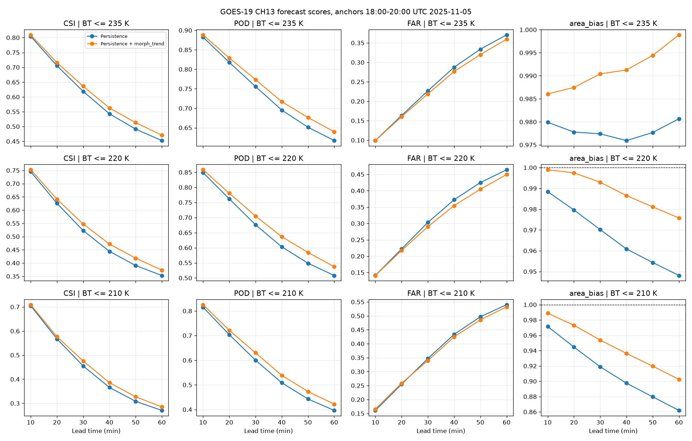

Forecasting
=======================================================

pyForTraCC can extrapolate tracked clusters into the near future (nowcasting). The forecast
module reads the tracking table you already produced with ``pyfortracc.track``, estimates how
each cluster is moving, and builds a sequence of *virtual images* for the next time steps.
Each virtual image is then processed by the tracking routine, so the forecast output has the
same structure as the tracking table. You can read, plot and analyse it with the same tools.

.. note::

   The forecast is a post-tracking step. Always run ``pyfortracc.track`` first, with the
   **same** ``name_list``, before calling ``pyfortracc.forecast``.

How the forecast works
-------------------------------------------------------

The only forecast mode available at the moment is **persistence** (``forecast_mode = 'persistence'``).
It assumes that each cluster keeps the mean motion it had in the recent past, and that its shape
and intensity do not change (unless ``morph_trend`` is enabled, see
:ref:`Growth and decay of the systems <BI/BI_FORECAST:Growth and decay of the systems (morph_trend)>`).
For a forecast issued at ``forecast_time``, each lead time
runs these steps:

1. **Select the observation window**: the last ``observation_window`` frames of the tracking table
   at or before ``forecast_time`` are read. Frames after ``forecast_time`` are ignored, so the
   forecast only uses data that would be available in real time.
2. **Select the active clusters**: only clusters present in the most recent frame with a valid
   displacement vector (``u_``, ``v_``) are extrapolated. Clusters without a vector (for example
   clusters that were ``NEW`` in the last frame) are not forecast.
3. **Compute the mean vector**: for each active cluster, the ``u_`` and ``v_`` components are
   averaged over the observation window. Groups are ``uid`` for single-threshold runs and
   ``iuid`` for multi-threshold runs.
4. **Build the virtual image**: each system (cluster of the first threshold) is shifted rigidly,
   with all its pixels (``array_x``, ``array_y``, ``array_values``), by its mean vector rounded
   to whole pixels, so the inner thresholds move with it and keep their place. With
   ``morph_trend = True`` the system is also dilated or eroded and its values follow its trend.
   Pixels moved out of the domain are dropped. Where two systems overlap, the most intense
   value is kept (the largest for the ``>`` operators, the smallest for ``<``).
5. **Track the virtual image**: the virtual image goes through features extraction, spatial
   operations (against the last frame), cluster linking and concatenation. Forecast clusters
   keep the ``uid`` of the observed cluster they came from, and their ``lifetime`` keeps
   increasing.
6. **Roll forward**: the new forecast frame is added to the observation window and the oldest
   frame is dropped. The next lead time is built from it, so lead time +2 is extrapolated from
   lead time +1, and so on.

.. code-block:: text

      observed frames (tracking table)            forecast frames (forecast table)
   ┌──────┬──────┬──────┐                     ┌──────┬──────┬──────┐
   │ t-2  │ t-1  │  t0  │  ── mean u, v ──►   │ t+1  │ t+2  │ t+3  │
   └──────┴──────┴──────┘                     └──────┴──────┴──────┘
    observation_window = 3                         lead_time = 3
                      ▲
                 forecast_time

Growth and decay of the systems (morph_trend)
-------------------------------------------------------

Plain persistence keeps the size of every system, so a growing system is under-forecast and a
decaying one is over-forecast. With ``name_list['morph_trend'] = True`` each moved system also
follows its own trend over the observation window:

* **Area trend**: the mean rate of change of the size of the cluster between consecutive
  frames. Only the steps where the cluster continues (status ``CON``, one ``delta_time`` apart,
  not touching the border of the domain) are used, since in a merge or a split the area jumps
  without the system growing. The rate is limited to a growth of 50% (or the inverse decay) per
  time step.
* **Dilation and erosion**: the system is dilated (growing) or eroded (decaying) to the
  forecast area, with a smooth border. A dilated system always contains the original one and an
  eroded system is always inside it. Every threshold has its own trend, and the inner thresholds
  stay nested in the outer ones.
* **Values**: the new pixels take a local average of the neighbouring values **of their own
  threshold level**, never a mean of the whole system, so no artificial cores are created and the
  field keeps its texture. All the values are then shifted by the trend of the mean value of the
  cluster, but they are kept inside their threshold level and within the extremes observed in the
  window. This keeps the method independent of the variable (reflectivity, brightness
  temperature, precipitation...).
* **Damping**: a growth or a decay does not last for ever, so the trends fade with the lead time
  (multiplied by ``0.6 ** n`` at the *n*-th step after the first). The trends are always taken
  from the **observed** frames, never from the forecast frames, so forecast errors are not fed
  back into the trends.

.. code-block:: python

    name_list['morph_trend'] = True
    pyfortracc.forecast(name_list, read_function)

.. note::

   ``morph_trend`` is not applied with the ``'=='`` and ``'!='`` operators, where the values are
   classes and have no intensity. The settings of the method (maximum rate, damping, border
   smoothing) are fixed constants in ``pyfortracc/forecast/morphology.py`` (``MAX_RATE``,
   ``DAMPING``, ``SIGMA``), so the ``name_list`` only switches it on or off.

The figure below compares the two modes with GOES-19 channel 13 (10.3 µm) brightness temperature
over South America (2025-11-05, forecasts issued every 30 min from 18:00 to 20:00 UTC, thresholds
235, 220 and 210 K). ``morph_trend`` improves POD and CSI at every lead time and brings the area
bias closer to 1 (for example, CSI at 235 K and +60 min: 0.47 against 0.45; area bias at 210 K and
+60 min: 0.90 against 0.86).

.. note::

   The damping was tuned on this same event, so these scores are optimistic. The test can be
   reproduced with ``tests/forecast_goes19.py``, which downloads the images with
   `goesgcp <https://github.com/helvecioneto/goesgcp>`_, tracks them, runs the forecast with
   ``morph_trend`` off and on, and saves the scores and comparison figures in
   ``tests/output_goes19/`` (``python forecast_goes19.py plots`` only redraws the figures).

Forecast parameters
-------------------------------------------------------

The forecast uses the same ``name_list`` as the tracking with the keys below added. The
three keys marked *required* must be set before calling ``pyfortracc.forecast``; if any
of them is missing, the function prints a message and returns without running.

.. list-table::
   :header-rows: 1
   :widths: 22 12 66

   * - Key
     - Default
     - Description
   * - ``forecast_time``
     - *required*
     - Issue time of the forecast, as a string ``'YYYY-MM-DD HH:MM:SS'``. It must be a timestamp
       that exists in the tracking table (the last observed frame). The first forecast step is
       ``forecast_time + delta_time``.
   * - ``observation_window``
     - *required*
     - Number of observed frames (up to and including ``forecast_time``) used to compute the mean
       displacement vector. A small window reacts faster to changes of direction; a larger one
       gives smoother, more stable vectors.
   * - ``lead_time``
     - *required*
     - Number of time steps to forecast. The forecast horizon is ``lead_time × delta_time``
       minutes (e.g. ``lead_time = 6`` with ``delta_time = 10`` forecasts one hour ahead).
   * - ``forecast_mode``
     - ``'persistence'``
     - Extrapolation method. Only ``'persistence'`` is implemented.
   * - ``morph_trend``
     - ``False``
     - Dilate/erode each system by its area trend and shift its values by its intensity trend,
       both taken from the observation window and damped with the lead time (see
       :ref:`Growth and decay of the systems <BI/BI_FORECAST:Growth and decay of the systems (morph_trend)>`).

Requirements
~~~~~~~~~~~~~~~~~~~~~~~~~~~~~~~~~~~~~~~~~~~~~~~~~~~~~~~

* **Cluster pixels in the tracking table.** The forecast moves the pixels of each cluster, so
  the tracking must be run with ``name_list['save_arrays'] = True`` (the default). If the
  tracking table was saved without the ``array_x``, ``array_y`` and ``array_values`` columns,
  ``forecast`` raises a ``ValueError``.
* **Geographic bounds.** Set ``lon_min``, ``lon_max``, ``lat_min`` and ``lat_max`` in the
  ``name_list``. The forecast images are saved as NetCDF files on this grid.

  .. warning::

     In the current version, running the forecast **without** geographic bounds does not
     write the forecast images, and every lead time comes out empty. If your data has no
     geographic reference, use pixel coordinates as bounds (for example
     ``lon_min = 0``, ``lon_max = x_dim``, ``lat_min = 0``, ``lat_max = y_dim``) when you
     track **and** forecast.

* **Same configuration as the tracking.** Thresholds, operator, minimum sizes and
  ``delta_time`` are reused to track the virtual images, so use the ``name_list`` that
  produced the tracking table.

Basic example
-------------------------------------------------------

The example below uses the synthetic dataset generated by ``pyfortracc.utilities.bubble_simulation``
(one PNG frame per minute), so you can run it without downloading data.

.. code-block:: python

    import numpy as np
    from PIL import Image
    import pyfortracc

    # 1. Synthetic input data: 30 PNG frames in input/
    pyfortracc.utilities.bubble_simulation(dir='input/')

    def read_function(path):
        img = np.array(Image.open(path).convert('L')).astype(float)
        return np.where(img < 250, 1.0, 0.0)   # 1 inside the bubbles, 0 outside

    # 2. Tracking configuration (with geographic bounds, required by the forecast)
    name_list = {
        'input_path': 'input/',
        'output_path': 'output/',
        'thresholds': [1],
        'min_cluster_size': [3],
        'operator': '>=',
        'timestamp_pattern': 'frame_%M.png',
        'delta_time': 1,                    # minutes between frames
        'lon_min': -60.0, 'lon_max': -55.0,
        'lat_min': -5.0,  'lat_max': 0.0,
    }

    if __name__ == '__main__':
        # 3. Track first
        pyfortracc.track(name_list, read_function)

        # 4. Forecast parameters
        name_list['forecast_time'] = '1900-01-01 00:15:00'  # last observed frame
        name_list['observation_window'] = 3                 # use 3 frames to get the mean vector
        name_list['lead_time'] = 3                          # forecast 3 steps (3 minutes)

        # 5. Run the forecast
        pyfortracc.forecast(name_list, read_function)

The console shows each lead time going through the tracking steps:

.. code-block:: text

    Forecasting window: 1900-01-01 00:16:00 to 1900-01-01 00:18:00

    - Generating forecast image lead time +1: 1900-01-01 00:16:00
      * Features Extraction
      * Spatial Operations
      * Linking Clusters
      * Concatenating Forecast Files
    ...

.. tip::

   The file names in this example only contain minutes (``frame_%M.png``), so Python
   assigns the default date ``1900-01-01`` to all timestamps. With real data, use a
   complete ``timestamp_pattern`` such as ``'%Y%m%d_%H%M.nc'``.

.. note::

   ``pyfortracc.forecast`` makes an internal copy of ``name_list``, so your dictionary is not
   changed by the call. You can reuse it in a loop (see :ref:`Rolling forecasts over a period <BI/BI_FORECAST:Rolling forecasts over a period>`).

Forecast outputs
-------------------------------------------------------

Each call to ``forecast`` creates one folder named after the issue time
(``forecast_time`` formatted as ``%Y%m%d_%H%M``):

.. code-block:: text

    output/
    ├── track/                      # tracking outputs (from pyfortracc.track)
    │   └── trackingtable/
    └── forecast/
        └── 19000101_0015/          # one folder per forecast_time
            ├── forecast_images/    # virtual images, one NetCDF per lead time
            │   ├── 19000101_001600.nc
            │   ├── 19000101_001700.nc
            │   └── 19000101_001800.nc
            ├── forecasttable/      # tracking table of the forecast, one parquet per lead time
            │   ├── 19000101_0016.parquet
            │   ├── 19000101_0017.parquet
            │   └── 19000101_0018.parquet
            ├── geometry/boundary/  # cluster boundaries as GeoJSON, one file per lead time
            └── processing/         # intermediate files (features, spatial, linked)

**forecasttable/**: same columns as the tracking table (see :ref:`Tracking Table <BI/BI_TRACKING:Tracking Table>`). Each row is a
forecast cluster. ``uid`` is the identifier of the observed cluster it was extrapolated from,
and ``u_`` / ``v_`` are the displacements measured between consecutive forecast frames.

**forecast_images/**: NetCDF files with a ``data`` variable of dimensions
``(threshold_level, lat, lon)``, with ``lat``/``lon`` at the pixel centres (``lat`` ascending,
row 0 = south). Pixels outside the forecast clusters are ``NaN``.

**geometry/boundary/**: the boundaries of the forecast clusters, ready to open in a GIS
(QGIS, ArcGIS, geopandas).

Reading the forecast
~~~~~~~~~~~~~~~~~~~~~~~~~~~~~~~~~~~~~~~~~~~~~~~~~~~~~~~

.. code-block:: python

    import glob
    import pandas as pd
    import xarray as xr

    run_dir = name_list['output_path'] + 'forecast/19000101_0015/'

    # Forecast table (all lead times)
    files = sorted(glob.glob(run_dir + 'forecasttable/*.parquet'))
    forecast_table = pd.concat(pd.read_parquet(f) for f in files)
    print(forecast_table[['timestamp', 'uid', 'status', 'size', 'lifetime', 'u_', 'v_']])

    # First forecast image
    image = xr.open_dataset(run_dir + 'forecast_images/19000101_001600.nc')
    image['data'].isel(threshold_level=0).plot()

    # Forecast boundaries
    import geopandas as gpd
    boundaries = gpd.read_file(run_dir + 'geometry/boundary/19000101_0016.GeoJSON')
    boundaries.boundary.plot()

Comparing forecast and observation of a single cluster:

.. code-block:: python

    tracking_files = sorted(glob.glob(name_list['output_path'] + 'track/trackingtable/*.parquet'))
    tracking_table = pd.concat(pd.read_parquet(f) for f in tracking_files)

    uid = 1
    observed = tracking_table.loc[tracking_table['uid'] == uid, ['timestamp', 'size']]
    forecast = forecast_table.loc[forecast_table['uid'] == uid, ['timestamp', 'size']]

    ax = observed.plot(x='timestamp', y='size', marker='o', label='observed')
    forecast.plot(x='timestamp', y='size', marker='x', ls='--', label='forecast', ax=ax)

Because persistence keeps each cluster's shape, the forecast ``size`` stays constant, while
the observed size keeps changing. This growth and decay is the main source of forecast error
for this method; ``morph_trend = True`` makes the forecast ``size`` follow the observed trend
of each cluster.

Rolling forecasts over a period
-------------------------------------------------------

To evaluate the method, or to simulate an operational nowcasting system, issue one forecast
for each observed time step. Each call is independent: it only uses the frames observed up to
its own ``forecast_time`` and writes to its own folder.

.. code-block:: python

    import pandas as pd

    if __name__ == '__main__':
        name_list['observation_window'] = 3
        name_list['lead_time'] = 3

        issue_times = pd.date_range('1900-01-01 00:10:00', '1900-01-01 00:12:00', freq='1min')
        for issue_time in issue_times:
            name_list['forecast_time'] = issue_time.strftime('%Y-%m-%d %H:%M:%S')
            pyfortracc.forecast(name_list, read_function)

This produces ``output/forecast/19000101_0010/``, ``19000101_0011/`` and ``19000101_0012/``.

.. tip::

   Use a ``freq`` equal to ``delta_time`` so that every ``forecast_time`` matches an existing
   frame of the tracking table.

Verifying the forecast
-------------------------------------------------------

The forecast can be verified with the frames that were later observed. The example below
rasterizes the pixels of the forecast and observed clusters and computes categorical
scores for each lead time:

* **POD** (probability of detection) = hits / (hits + misses)
* **FAR** (false alarm ratio) = false alarms / (hits + false alarms)
* **CSI** (critical success index) = hits / (hits + misses + false alarms)

.. code-block:: python

    import glob
    import pathlib
    import numpy as np
    import pandas as pd

    ny, nx = 50, 50  # grid size of the input data (y_dim, x_dim)

    def to_mask(df, ny, nx):
        """Rasterize the pixels of all clusters of a frame into a boolean mask."""
        mask = np.zeros((ny, nx), dtype=bool)
        for ys, xs in zip(df['array_y'], df['array_x']):
            mask[np.asarray(ys, dtype=int), np.asarray(xs, dtype=int)] = True
        return mask

    rows = []
    for run_dir in sorted(glob.glob(name_list['output_path'] + 'forecast/*/')):
        issue_time = pd.to_datetime(pathlib.Path(run_dir).name, format='%Y%m%d_%H%M')
        fc_files = sorted(glob.glob(run_dir + 'forecasttable/*.parquet'))
        for lead, fc_file in enumerate(fc_files, start=1):
            # Observed frame with the same timestamp
            obs_file = (name_list['output_path'] + 'track/trackingtable/'
                        + pathlib.Path(fc_file).name)
            if not pathlib.Path(obs_file).exists():
                continue
            cols = ['threshold_level', 'array_y', 'array_x']
            fc = pd.read_parquet(fc_file, columns=cols)
            ob = pd.read_parquet(obs_file, columns=cols)
            # Evaluate the first threshold
            fc_mask = to_mask(fc[fc['threshold_level'] == 0], ny, nx)
            ob_mask = to_mask(ob[ob['threshold_level'] == 0], ny, nx)
            hits = np.sum(fc_mask & ob_mask)
            misses = np.sum(~fc_mask & ob_mask)
            false_alarms = np.sum(fc_mask & ~ob_mask)
            rows.append({
                'issue_time': issue_time,
                'lead_time': lead,
                'POD': hits / (hits + misses) if hits + misses else np.nan,
                'FAR': false_alarms / (hits + false_alarms) if hits + false_alarms else np.nan,
                'CSI': hits / (hits + misses + false_alarms) if hits + misses + false_alarms else np.nan,
            })

    scores = pd.DataFrame(rows)
    print(scores.groupby('lead_time')[['POD', 'FAR', 'CSI']].mean())

With the synthetic dataset, the scores get worse as the lead time increases:

.. code-block:: text

                    POD       FAR       CSI
    lead_time
    1          0.891987  0.101563  0.805296
    2          0.811877  0.190142  0.666352
    3          0.755973  0.319799  0.541276

Choosing the parameters
-------------------------------------------------------

* **observation_window**: start with 2–4 frames. Increase it if the vectors are noisy
  (e.g. radar data with frequent deformations). Decrease it if the systems change direction
  quickly.
* **lead_time**: persistence forecasts lose skill quickly because clusters grow, decay,
  split and merge. For convective systems, horizons up to about 1–2 hours are usually the most
  useful.
* **Vector corrections**: the forecast uses the ``u_`` and ``v_`` columns. When
  ``validation = True`` is used during tracking, these columns hold the vector of the best
  correction method for each cluster (see :doc:`BI_TRACKING`). Better vectors lead to better
  forecasts.
* **Multiple thresholds**: every threshold is forecast. The internal clusters (``iuid``) move
  with the system that contains them; an internal cluster outside every cluster of the first
  threshold is moved by its own vector.
* **morph_trend**: enable it when the systems grow or decay during the forecast horizon (e.g.
  convection). It needs ``observation_window >= 2`` to measure a trend; with a single frame, or
  for systems with no ``CON`` step in the window, the systems are only moved.

Limitations
-------------------------------------------------------

* Only the **persistence** mode is available. With ``morph_trend`` the growth and decay of the
  systems follow their observed trends, but no splitting, merging or initiation is predicted.
* Clusters that appear after ``forecast_time`` cannot be forecast, and clusters without a
  displacement vector in the last observed frame are skipped.
* Pixels moved outside the domain are dropped (with ``edges = True`` they wrap around in
  longitude).
